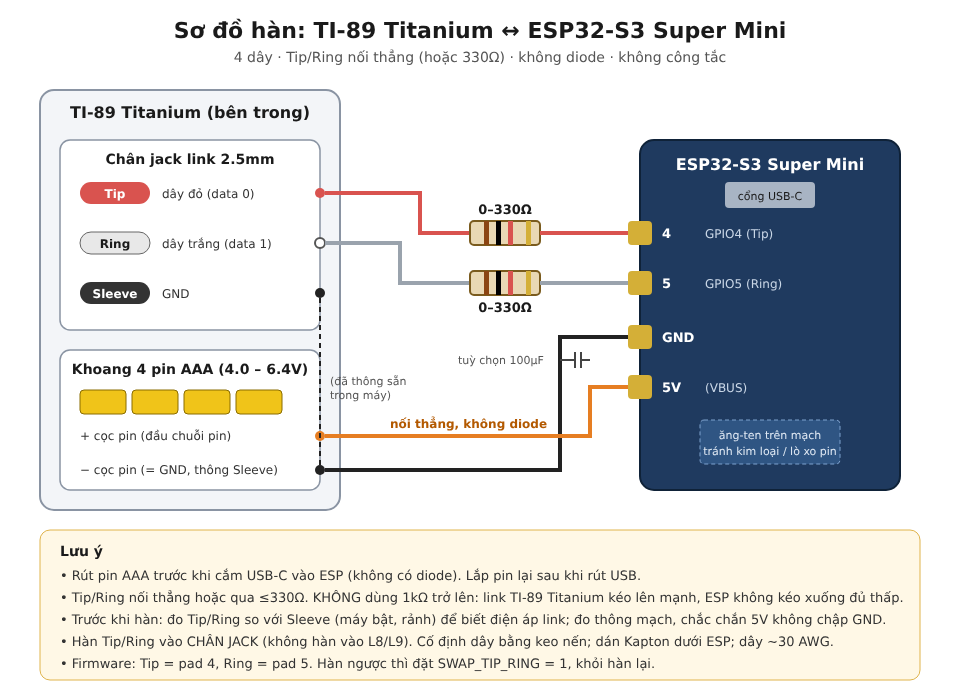
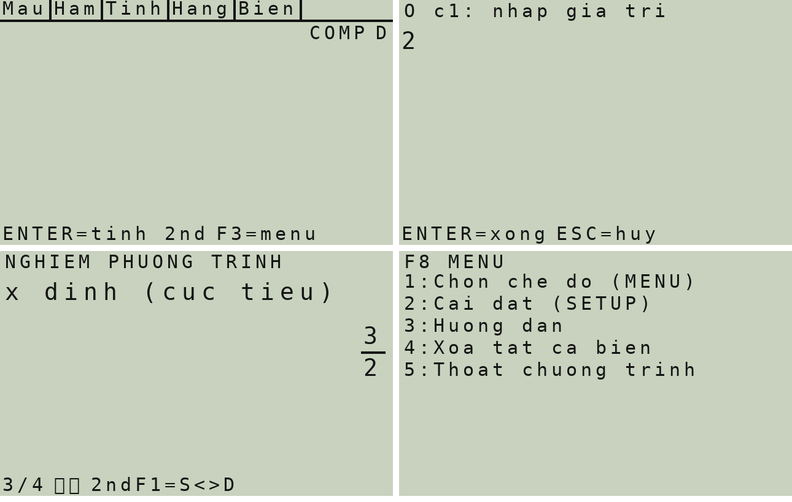

# TI-89 Claude Link

**An ESP32-S3 soldered inside a TI-89 Titanium: ask Claude AI from the calculator, use the keyboard as a Bluetooth gamepad, and get a Casio fx-580VN X style natural-display calculator.**

*Một con ESP32-S3 hàn bên trong TI-89 Titanium: hỏi Claude AI ngay trên máy, dùng bàn phím làm tay cầm Bluetooth, kèm chương trình máy tính nhập tự nhiên kiểu Casio fx-580VN X.* → [Tiếng Việt bên dưới](#tiếng-việt)



---

## English

### What's inside

| Program | Needs the ESP32? | What it does |
|---|---|---|
| `gpt()` | yes | Type a question; the ESP32 asks Claude (Anthropic API) over WiFi; the answer is shown paged on the screen. |
| `pad()` | yes | The TI-89 keyboard becomes a standard BLE HID gamepad (Windows, Android, …). |
| `casio()` | **no** | A natural-display calculator modelled on the Casio fx-580VN X, running on the TI-89 CAS. Works on any TI-89 Titanium. |

### Hardware

| Part | Notes |
|---|---|
| TI-89 Titanium | Developed and tested on a TI-89 Titanium (AMS 3.x). |
| ESP32-S3 Super Mini | Onboard RGB LED on GPIO48. GPIO4 = Tip, GPIO5 = Ring. |
| Thin wire (~30 AWG) | 4 wires: Tip, Ring, GND, 5V. |
| 0–330 Ω resistors (optional) | In series on Tip/Ring. **Do not use 1 kΩ or more.** |

| TI-89 | ESP32-S3 Super Mini |
|---|---|
| Link jack **Tip** | pad **4** |
| Link jack **Ring** | pad **5** |
| Battery **−** (= Sleeve/GND) | **GND** |
| Battery **+** (4×AAA) | **5V** (no diode) |

> ⚠️ There is no diode on the power line: **always remove the AAA batteries before plugging USB into the ESP32.**
> Solder Tip/Ring to the **jack pins themselves**, not to nearby parts such as L8/L9 (see `docs/jack_board_photo.png`).
> If Tip/Ring ended up swapped, set `SWAP_TIP_RING 1` in the firmware instead of re-soldering.
> Keep the ESP32 board and wires from pressing on the back of the LCD.

### 1. ESP32 firmware (Arduino IDE)

1. Install the board package **esp32** (Espressif Systems).
2. Install the libraries **ArduinoJson** (v7), **ESP32-BLE-Gamepad** (lemmingDev) and **NimBLE-Arduino** (h2zero).
3. Open `firmware/ti89_combo_esp32/ti89_combo_esp32.ino` and fill in the three lines at the top:
   ```cpp
   const char* WIFI_SSID  = "TEN_WIFI";       // 2.4 GHz only
   const char* WIFI_PASS  = "MAT_KHAU_WIFI";
   const char* CLAUDE_KEY = "sk-ant-...";     // https://console.anthropic.com
   ```
   **Never commit your real WiFi password or API key.** Fill them in only in your local copy.
4. Tools: Board **ESP32S3 Dev Module**, USB CDC On Boot **Enabled**, Flash Size **4MB**, Partition Scheme **Huge APP**.
5. Upload with the AAA batteries removed. If upload fails: hold **BOOT**, tap **RST**, release **BOOT**, upload again.

| Define | Meaning |
|---|---|
| `ECHO_TEST` | `1` = reply with the question itself (tests the link without WiFi) |
| `USE_BLE` | `0` = build without Bluetooth |
| `SWAP_TIP_RING` | `1` if Tip/Ring are soldered the other way round |
| `LED_DEBUG` | `1` = RGB LED status codes for debugging. **Keep `0` for daily use** (see Troubleshooting) |
| `USE_SLEEP` | light sleep after 10 min idle |

### 2. TI-89 programs

Send these with TiLP or TI Connect, then **Archive** them (VAR-LINK → F1 → Archive) so they survive a battery change:

- `ti89/bin/gpt.89z`, `ti89/bin/pad.89z`
- `casio/bin/casio.89z` **and** `casio/bin/casiodat.89y` (both are needed; `casio` is a small launcher for the compressed `casiodat`)

Unplug the TI-89's own USB cable while using the link port. To build from source use [GCC4TI](https://github.com/debrouxl/gcc4ti): `tigcc -O2 gpt.c -o gpt`, and `casio/build.sh` for `casio()`.

### Using `gpt()`

Run `gpt()`, type the question, press **ENTER** (first question ≈ 5–15 s while WiFi connects). Commands typed as a question:

| Command | Action |
|---|---|
| `/help` | list commands |
| `/model`, `/models`, `/model sonnet\|haiku\|opus\|<id>\|reset` | show / switch model (saved in flash) |
| `/wifi` | scan networks and test the connection |
| `/log`, `/logclear` | read / clear the debug log |
| `/paddemo` | press every gamepad button automatically |
| `/unpair` | forget all Bluetooth pairings |
| `/linetest` | check the Tip/Ring wires |

### Using `pad()`

Run `pad()`, pair **"TI-89 Gamepad"** on the host (only one host at a time), exit with **ON** or **ESC+CLEAR**.

| TI-89 | Button | TI-89 | Button |
|---|---|---|---|
| Arrows | D-pad | F1 / F5 | LB / RB |
| ENTER | A | F2 / F4 | LT / RT |
| ESC | B | HOME / MODE | Start / Back |
| 2nd | X | F3 | Guide |
| ◆ | Y | shift / alpha | L3 / R3 |

Many PC games only accept XInput controllers; use Steam Input or x360ce to map this DirectInput gamepad. If Windows says *"Try connecting your device again"*, remove the old pairing in Windows, run `/unpair`, and pair again.

### Using `casio()`



Type like on a Casio: **÷** makes a stacked fraction (the number before it becomes the numerator), **^** a power, the arrow keys move between boxes. **ENTER** calculates, **CLEAR** clears, **ESC** quits.

| Key | Function |
|---|---|
| F1 | templates: fraction, mixed number, √, ³√, ⁿ√, x², x³, x⁻¹, xⁿ, 10ˣ, eˣ, \|x\|, logₐb |
| F2 | sin cos tan, inverses, sinh cosh tanh, inverses, ln, log |
| F3 | d/dx, ∫, Σ, Π, x!, nPr, nCr, %, ÷R, Pol, Rec, GCD, LCM, Int, Intg, Ran#, RanInt#, °′″, solve/factor/expand |
| F4 | π, e, i, 40 physical constants, 40 unit conversions, Ans, PreAns, complex functions |
| F5 | STO, RCL, M+, M−, CALC, SOLVE |
| 2nd F1 (F6) or ◆ENTER | S⇔D: fraction → recurring decimal → decimal |
| 2nd F2 (F7) | mixed number, ENG, °′″, FACT |
| 2nd F3 (F8) | modes, SETUP (angle, Fix/Sci/Norm, fraction format, complex format, font size), help |
| 2nd X/Y/Z/T | ln, sin, cos, tan; ◆X/Y/Z/T: eˣ, sin⁻¹, cos⁻¹, tan⁻¹ |

Modes: Calculate, Complex, Equation (systems with 2–4 unknowns, polynomials of degree 2–4 with extrema), Inequality, Table, Verify, Ratio. Not done yet: Matrix, Vector, Statistics, Distribution, Base-N, Spreadsheet.

Needs about 90 KB of free RAM. The settings change the TI's own MODE (angle unit, display digits, complex format).

### Troubleshooting and lessons learned

1. **Answer never shows although the ESP log says "sent OK".** `OSLinkReset()` also closes the link: call `OSLinkReset()` first, then `OSLinkOpen()`.
2. **The TI doesn't see the ESP's acknowledge (purple LED).** The Titanium's link pull-ups are strong, so a 1 kΩ series resistor is too much; the ESP must ACK within microseconds (`FRAME_STABLE_US` = 20 µs); solder to the jack pins, not near L8/L9.
3. **Garbage frames.** A link reset pulls both lines low for ~200 µs; the firmware ignores any "bit" with both lines low.
4. **Calculator turns itself on.** Any glitch on the link lines wakes the TI-89. The RGB LED's current spikes on 4×AAA were enough: keep `LED_DEBUG 0`. The firmware also holds the link pins during its own restarts.
5. **WiFi never connects.** ESP32 is 2.4 GHz only (iPhone hotspot: enable *Maximize Compatibility*). Use `/wifi`.
6. **`casio()` lessons.** Key codes on the Titanium are 4096 + key for 2nd and 16384 + key for ◆; MODE numbering differs between AMS versions, so `casio()` sets a mode and then verifies it with a test calculation; big local arrays overflow the small AMS stack (shows as a "Memory" error).

Debug tools in `tools/`:

| Pair | Purpose |
|---|---|
| `ringfind.89z` + `do_chan.ino` | The TI pulses Tip or Ring; the ESP LED shows which wire sees it. |
| `linestat.89z` + `keo_day.ino` | The ESP pulls each line; the TI shows the raw link port. |
| `keytest.89z` | Shows the keyboard matrix (used to build the gamepad map). |

### Protocol

Standard TI 2-wire link (open-drain, LSB first; pull Tip for 0, Ring for 1; the receiver acks on the other line). Frames: `[lenLo][lenHi][cmd][data…]`.

| Cmd | Direction | Meaning |
|---|---|---|
| `Q` + text | TI → ESP | question; the ESP replies `[lenLo][lenHi][text]` |
| `P` | TI → ESP | start the gamepad |
| `K` + 10 bytes | TI → ESP | keyboard matrix rows |
| `X` | TI → ESP | exit the gamepad |

### Repo layout

```
firmware/ti89_combo_esp32/   ESP32 firmware (fill in WiFi + API key locally)
ti89/src, ti89/bin           gpt, pad, keytest (C source + .89z)
casio/src, casio/bin         casio() calculator (C source + .89z/.89y), build.sh
tools/                       wiring/debug helpers
docs/                        wiring diagram, jack pinout, photos
```

### Notes

- Each question costs API tokens; `/model haiku` is the cheapest.
- If an API key ever leaks, revoke it in the Anthropic Console.
- Hobby project: opening and soldering your calculator is at your own risk. Not affiliated with Texas Instruments, Casio or Anthropic.

---

## Tiếng Việt

### Có gì trong này

| Chương trình | Cần ESP32? | Chức năng |
|---|---|---|
| `gpt()` | có | Gõ câu hỏi, ESP32 hỏi Claude qua WiFi, câu trả lời hiện trên màn hình (chia trang). |
| `pad()` | có | Bàn phím TI-89 thành tay cầm Bluetooth chuẩn BLE (Windows, Android…). |
| `casio()` | **không** | Máy tính nhập tự nhiên kiểu Casio fx-580VN X, dùng bộ CAS của TI-89. Chạy được trên mọi TI-89 Titanium. |

### Hàn dây

| TI-89 | ESP32-S3 Super Mini |
|---|---|
| Chân jack **Tip** | pad **4** |
| Chân jack **Ring** | pad **5** |
| Cọc **−** pin (= GND) | **GND** |
| Cọc **+** pin (4×AAA) | **5V** (không diode) |

- **Tháo pin AAA trước khi cắm USB vào ESP.**
- Hàn Tip/Ring vào **chân jack**, không hàn vào L8/L9. Nếu hàn ngược Tip/Ring thì đặt `SWAP_TIP_RING 1`.
- Điện trở nối tiếp tối đa 330Ω, **không dùng 1kΩ**.
- Không để bo ESP hay dây đè lên mặt sau màn hình.

### Nạp firmware ESP32

1. Arduino IDE: cài board **esp32**, thư viện **ArduinoJson**, **ESP32-BLE-Gamepad**, **NimBLE-Arduino**.
2. Mở `firmware/ti89_combo_esp32/ti89_combo_esp32.ino`, điền tên WiFi (chỉ 2.4 GHz), mật khẩu và Claude API key vào 3 dòng đầu file. **Không đưa key thật lên GitHub.**
3. Board **ESP32S3 Dev Module**, USB CDC On Boot **Enabled**, Flash **4MB**, Partition **Huge APP**.
4. Tháo pin AAA rồi nạp. Lỗi nạp: giữ **BOOT**, bấm **RST**, thả **BOOT**, nạp lại.
5. Để `LED_DEBUG 0` khi dùng hằng ngày. LED làm sụt áp pin khiến máy tự bật.

### Chép chương trình vào TI-89

Dùng TiLP hoặc TI Connect gửi các file sau, rồi **Archive** (VAR-LINK → F1 → Archive) để thay pin không bị mất:

- `ti89/bin/gpt.89z`, `ti89/bin/pad.89z`
- `casio/bin/casio.89z` **và** `casio/bin/casiodat.89y` (cần cả hai)

Rút cáp USB của TI-89 khi dùng cổng link.

### Cách dùng

- **`gpt()`:** gõ câu hỏi, ENTER. Gõ `/help` để xem các lệnh (đổi model, kiểm tra WiFi, xem log, `/unpair`…).
- **`pad()`:** ghép "TI-89 Gamepad" trên máy tính/điện thoại (mỗi lúc chỉ một thiết bị). Thoát bằng ON hoặc ESC+CLEAR. Windows báo "Try connecting your device again" thì xóa thiết bị cũ trong Windows, gõ `/unpair`, rồi ghép lại.
- **`casio()`:** gõ như Casio. **÷** tạo phân số chồng, **^** lũy thừa, mũi tên di chuyển giữa các ô, ENTER tính, CLEAR xóa, ESC thoát.
  - F1 mẫu (phân số, hỗn số, căn, mũ, log), F2 hàm lượng giác/ln/log, F3 đạo hàm, tích phân, Σ, Π, nCr, ÷R, Pol, Rec…, F4 hằng số, đổi đơn vị, số phức, F5 STO/RCL/M+/CALC/SOLVE.
  - 2nd F1 (hoặc ◆ENTER): S⇔D. 2nd F2: hỗn số, ENG, độ phút giây, FACT. 2nd F3: chế độ, cài đặt (góc, Fix/Sci, cỡ chữ…), hướng dẫn.
  - Chế độ: Tính toán, Số phức, Phương trình/Hệ phương trình, Bất phương trình, Bảng giá trị, Kiểm tra, Tỉ lệ. Chưa có: Ma trận, Vectơ, Thống kê, Phân phối, Cơ số N, Bảng tính.
  - Cần khoảng 90KB RAM trống.

### Lỗi đã gặp

1. Câu trả lời không hiện: phải gọi `OSLinkReset()` **trước** `OSLinkOpen()`.
2. TI không thấy ESP trả lời (LED tím): bỏ điện trở 1kΩ, hàn đúng chân jack.
3. Máy tự bật: tắt `LED_DEBUG`.
4. WiFi không kết nối: ESP chỉ chạy 2.4 GHz, kiểm tra bằng `/wifi`.
5. Tay cầm vào game không nhận: dùng Steam Input hoặc x360ce.

Dự án làm chơi: tự mở và hàn máy tính là rủi ro của bạn. Không liên quan đến Texas Instruments, Casio hay Anthropic.
